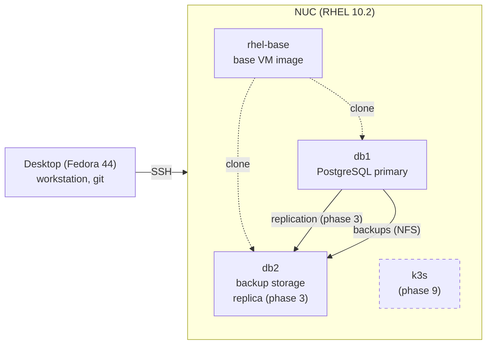

# rhel-data-platform

A learning project. I build a small PostgreSQL setup on Red Hat Enterprise Linux 10 in a home lab. I do each step by hand first, then automate it.

What I learn here:

- **RHEL 10 administration** (RHCSA / EX200 topics): storage, SELinux, firewall, systemd, networking and backups, all on a database server.
- **PostgreSQL administration**: backups and point-in-time recovery, replication and failover, roles and TLS, performance tuning and high availability.
- **Automation**: build the VMs with Terraform and configure them with Ansible, so one command builds the whole lab.
- **Operations**: monitoring, alerts and logs, service levels, restore checks and planned failure drills.
- **Containers and Kubernetes**: Podman, then k3s with the CloudNativePG operator, managed through GitOps.

## Lab

Dashed boxes are planned. Details: [architecture](docs/architecture/), [runbooks](docs/runbooks/), [decisions](docs/decisions/); all docs: [docs/](docs/)

## Roadmap

| # | Phase | Status |
|---|---|---|
| 0 | Lab: the NUC from a kickstart, KVM, a base VM image, db1 and db2 | done |
| 1 | PostgreSQL by hand: LVM, XFS, SELinux, firewall, timers, NFS | done |
| 2 | RHCSA practice: exam topics, practice exams and drills, then EX200 | in progress |
| 3 | PostgreSQL operations: backups and recovery, replication, failover, roles, TLS | in progress |
| 4 | Ansible: base role, security baseline, PostgreSQL as code, Vault, CI | planned |
| 5 | Lab as code: cloud-init, Terraform, a one-command build | planned |
| 6 | Containers and observability: Podman, Prometheus, Grafana, alerts, Loki | planned |
| 7 | PostgreSQL performance: query tuning, maintenance, OS tuning, PgBouncer | planned |
| 8 | PostgreSQL high availability: Patroni, measured failover, upgrades, game days | planned |
| 9 | Kubernetes and GitOps: k3s, Argo CD, CloudNativePG | planned |

Right now I am preparing for the RHCSA exam (EX200) with 3-hour practice exams and drills on single topics. Scores and lessons are in the journal.

Full list: [docs/roadmap.md](docs/roadmap.md). Session notes: [docs/journal/](docs/journal/).
