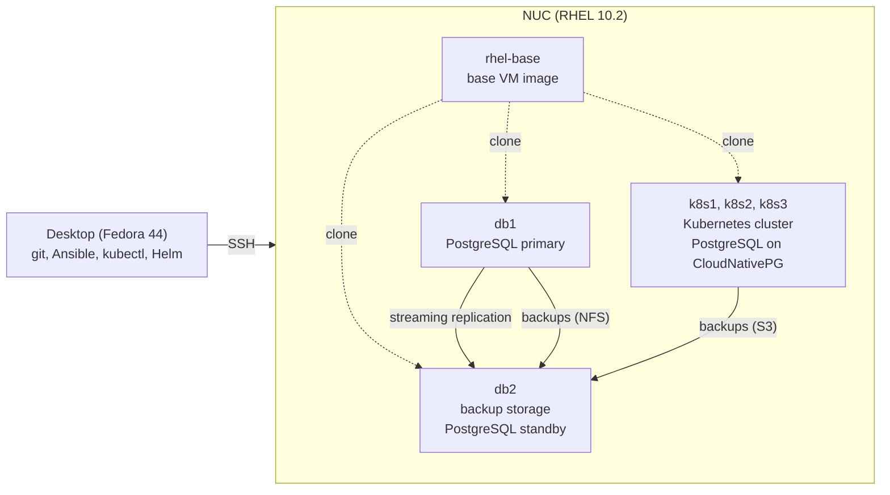

# RHEL Data Platform

PostgreSQL platform on RHEL 10 in a KVM home lab, with replication, backups, Ansible and Kubernetes.
I build each part by hand first, then automate it.

It is a learning project that builds a foundation for RHCSA, RHCE with Ansible and CKA, with a separate [RHCSA practice lab](https://github.com/marin-orejas/rhcsa-practice-lab).

## Highlights

- db2 stayed at most 0.33 s behind db1 during a 1,000,000-row insert.
- CloudNativePG failed over in 72.9 s when a worker lost power, against 5 min 51 s by hand, with no rows lost.
- A restore to a set time brought back a dropped table, with 1.1 s of outage by pgBackRest and none on CloudNativePG.
- One Ansible playbook builds db1 and db2 from fresh clones, db1 in 3 min 46 s.
- kubeadm upgraded the 3-node cluster one node at a time, with PostgreSQL writes stopped at most 20.3 s and no rows lost.

## Lab

Every VM is a clone of rhel-base, a base image from a kickstart file, on the NAT network of the nuc.
The [host pages](docs/architecture/hosts/) describe the nuc, the VMs and their system settings.

| Host | Role | CPU / RAM | Disk |
|---|---|---|---|
| desktop | Fedora 44 workstation, Ansible control node | i3-12100F / 16 GB | 240 GB SSD |
| nuc | RHEL 10.2 KVM host with Cockpit, no monitor | i3-1315U / 16 GB | 120 GB SSD |
| rhel-base | Base VM image, only for cloning | 2 CPU / 2 GB | 20 GB |
| db1 | PostgreSQL primary | 2 CPU / 3 GB | 20 GB + 10 GB data |
| db2 | Backup storage (NFS, S3), PostgreSQL standby | 2 CPU / 3 GB | 20 GB + 10 GB data + 5 GB S3 |
| k8s1 | Kubernetes control plane with CRI-O | 2 CPU / 3 GB | 20 GB |
| k8s2 | Kubernetes worker with CRI-O | 2 CPU / 2.5 GB | 20 GB + 5 GB data |
| k8s3 | Kubernetes worker with CRI-O | 2 CPU / 2.5 GB | 20 GB + 5 GB data |

## RHEL administration

db1 and db2 run SELinux in enforcing mode.
[Check scripts](checks/) verify that every setting still works after a reboot.

| Topic | Result |
|---|---|
| Storage | Data disk with LVM and XFS, mounted on `/pgdata` by UUID |
| Remote access | PostgreSQL on port 5433, reached from db2 through SELinux and firewalld |
| Tuning | Own tuned profile for PostgreSQL |
| Shared directory | `dba` group with setgid, default ACLs and a umask |
| Backups | Dumps from a systemd timer, an NFS share mounted with autofs |
| Full disk | Volume grown while a `psql` session stayed open |
| Emergency boot | db2 booted into emergency mode from GRUB |
| Object store | Garage S3 on its own disk, TLS through nginx, an SELinux boolean |

## PostgreSQL

db1 runs PostgreSQL 18 as the primary, and db2 keeps its standby and its backups.
The [PostgreSQL pages](docs/architecture/postgresql/) and the [backup pages](docs/architecture/backups/) describe each part.

| Topic | Result |
|---|---|
| Replication | db2 as a streaming standby, at most 0.33 s behind |
| Failover | db2 took over in 5 min 51 s by the [failover runbook](docs/runbooks/fail-over-to-db2.md), db1 came back with `pg_rewind` |
| Backups | pgBackRest every night to db2, over NFS |
| Restore test | Newest backup restored on db2 and compared with the standby in 18 s |
| Restore to a set time | Dropped table back in 9 min 31 s by hand, 1.1 s of outage with pgBackRest |
| Access | App login, read-only login, TLS from my own lab CA |

## Ansible

One playbook builds db1 and db2 from fresh clones, and a second run changes nothing.
The [Ansible pages](docs/architecture/ansible/) describe each role, and GitHub Actions lints every change to the code.

| Role | What it keeps |
|---|---|
| `base` | System settings on db1, db2 and the Kubernetes nodes |
| `storage` | Data disks, through the RHEL system role |
| `postgresql` | PostgreSQL and its logins, the standby on db2, TLS keys in Ansible Vault |
| `nfs` | Backup share on db2 |
| `pgbackrest` | pgBackRest backups to the NFS share |
| `pgdump` | Nightly dumps |
| `garage` | S3 object store on db2, nginx with TLS, keys in Ansible Vault |

## Kubernetes

kubeadm built the [cluster](docs/architecture/kubernetes/) from a config file on 3 clones of the base image.
I use `kubectl` and Helm from my desktop through an SSH tunnel over the nuc.

| Part | Result |
|---|---|
| Cluster | kubeadm, CRI-O and Calico, upgraded node by node, an etcd snapshot restored with 45.9 s of API outage |
| App | httpd Deployment with health checks, a rolling update and rollback |
| Settings | Kustomize, a ConfigMap, a Secret kept out of the repo |
| In-cluster access | Service with a DNS name, network policies for a single client pod |
| Outside access | MetalLB address on the lab network, Traefik with a Gateway API route |
| Storage | TopoLVM volume on the data disk of each worker, grown while its pod ran |
| PostgreSQL | CloudNativePG primary and standby, failover in 72.9 s, switchover on a drain in 20.3 s |
| Backups | WAL archive and nightly backups to S3 on db2, a dropped table back in 67 s |

## Tech stack

| Layer | Tools |
|---|---|
| Host | RHEL 10, KVM, libvirt, Cockpit, Kickstart |
| System | LVM, XFS, SELinux, firewalld, systemd, tuned, autofs, NFS, nginx, Garage |
| Database | PostgreSQL 18, pgBackRest, Barman Cloud |
| Automation | Ansible, Ansible Vault, Bash, GitHub Actions |
| Kubernetes | kubeadm, CRI-O, Calico, Kustomize, Helm, MetalLB, Traefik, TopoLVM, CloudNativePG |
| Workstation | Fedora 44, OpenSSH, kubectl |

## Project structure

| Folder | Contents |
|---|---|
| [`ansible/`](ansible/) | Roles, playbooks, inventory |
| [`checks/`](checks/) | 30 check scripts, numbered by the lessons of the [roadmap](docs/roadmap.md) |
| [`kickstart/`](kickstart/) | Kickstart files for the nuc and the base image |
| [`kubernetes/`](kubernetes/) | kubeadm config, app manifests, Helm values |
| [`docs/architecture/`](docs/architecture/) | What is built, a folder per area |
| [`docs/runbooks/`](docs/runbooks/) | Tested procedures, step by step |
| [`docs/decisions/`](docs/decisions/) | Why the lab is built this way |
| [`docs/journal/`](docs/journal/) | My notes, a file per lesson day |

## License

MIT, see [LICENSE](LICENSE).
