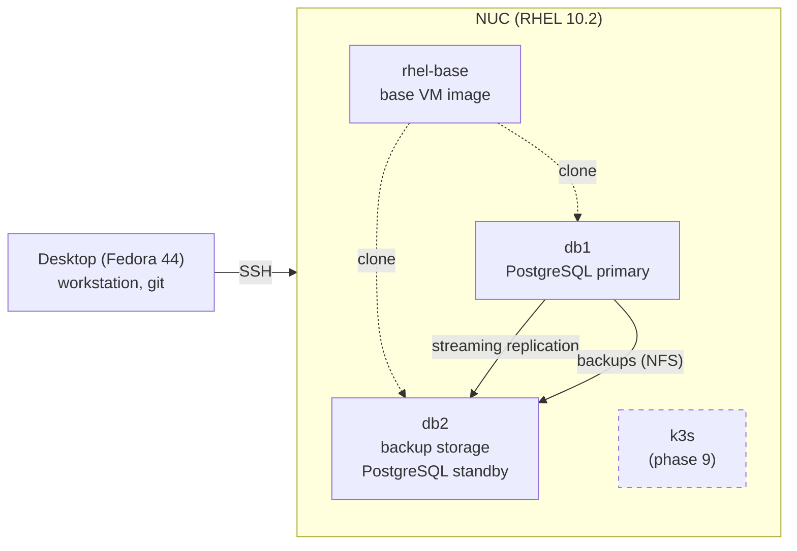

# rhel-data-platform

A learning project. I build a small PostgreSQL setup on Red Hat Enterprise Linux 10 in a home lab. I do each step by hand first, then automate it.

What I learn here:

- **RHEL 10 administration** (RHCSA / EX200 topics): storage, SELinux, firewall, systemd, networking and backups, all on a database server.
- **PostgreSQL administration**: backups and point-in-time recovery, replication and failover, roles and TLS, performance tuning and high availability.
- **Automation**: build the VMs with Terraform and configure them with Ansible, so one command builds the whole lab.
- **Operations**: monitoring, alerts and logs, service levels, restore checks and planned failure drills.
- **Containers and Kubernetes**: Podman, then k3s with the CloudNativePG operator, managed through GitOps.

## What works now

- db1 runs PostgreSQL 18 on its own data disk, with SELinux enforcing. [Check scripts](checks/) verify every setting after a reboot.
- db2 is a streaming standby. During a 1,000,000-row insert on db1 it stayed at most 0.33 s behind.
- pgBackRest backs db1 up to db2 every night. A dropped table came back with a restore to a set time: 9 min 31 s by hand, 1.1 s of outage with pgBackRest.
- RHCSA practice: every exam from exam 09 on passed, see [EX200 practice](docs/journal/ex200-practice.md).

## Lab

Dashed boxes are planned.

| Host | Role | CPU / RAM | Disk |
|---|---|---|---|
| desktop | Workstation, git, SSH, later Ansible; Fedora 44 | i3-12100F / 16 GB | |
| nuc | KVM host with Cockpit, no monitor; RHEL 10.2 | i3-1315U / 16 GB | 120 GB SSD |
| rhel-base | Base VM image, only for cloning | 2 CPU / 2 GB | 20 GB |
| db1 | PostgreSQL primary | 2 CPU / 3 GB | 20 GB + 10 GB data |
| db2 | Backup storage (NFS), PostgreSQL standby | 2 CPU / 3 GB | 20 GB + 10 GB data |
| k3s | Kubernetes (phase 9, planned) | 2 CPU / 4 GB | 30 GB |

## Docs

| Folder | What it holds |
|---|---|
| [architecture](docs/architecture/) | One page per layer: [NUC host](docs/architecture/host.md), [VMs](docs/architecture/vms.md), [PostgreSQL](docs/architecture/postgresql.md), [backups](docs/architecture/backups.md), [NFS](docs/architecture/nfs.md), [system settings](docs/architecture/system.md) |
| [runbooks](docs/runbooks/) | Tested procedures, step by step |
| [decisions](docs/decisions/) | Why the lab is built this way, one record per decision |
| [journal](docs/journal/) | My notes, one file per lesson day, and the EX200 practice results |

## Roadmap

| # | Phase | Status |
|---|---|---|
| 0 | Lab: the NUC from a kickstart, KVM, a base VM image, db1 and db2 | done |
| 1 | PostgreSQL by hand: LVM, XFS, SELinux, firewall, timers, NFS | done |
| 2 | RHCSA practice: exam topics, practice exams and drills, then EX200 | in progress |
| 3 | PostgreSQL operations: backups and recovery, replication, failover, roles, TLS | in progress |
| 4 | Ansible: base role, security baseline, PostgreSQL as code, Vault, CI | planned |
| 5 | Lab as code: cloud-init, Terraform, a one-command build | planned |
| 6 | Containers and observability: Podman, Prometheus, Grafana, alerts, Loki | planned |
| 7 | PostgreSQL performance: query tuning, maintenance, OS tuning, PgBouncer | planned |
| 8 | PostgreSQL high availability: Patroni, measured failover, upgrades, game days | planned |
| 9 | Kubernetes and GitOps: k3s, Argo CD, CloudNativePG | planned |

Right now I am on phase 3: point-in-time recovery, pgBackRest and streaming replication are done, and failover is next. The RHCSA exam (EX200) is booked.

Full list: [docs/roadmap.md](docs/roadmap.md).
