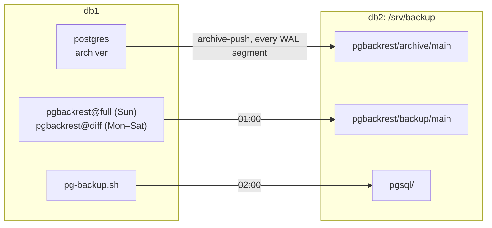

# NFS share

db2 shares `/srv/backup` with db1 over NFS, so the backups of db1 are not on the same machine as the database. db1 mounts the share with autofs when a program opens it.

Checks: [10](../../../checks/10-nfs.sh) · Managed by: [Role nfs](../ansible/nfs.md)

## Setup

### Export on db2

| Part | Setup |
|---|---|
| Package | `nfs-utils` on db2 and db1 |
| Service | `nfs-server` on db2, enabled |
| Export | `/etc/exports.d/backup.exports`: `/srv/backup 192.168.122.11(rw)`, the other options default (`sync`, `sec=sys`, `root_squash`) |
| Firewall, SELinux | Service `nfs`, `var_t` on the export ([System settings](../hosts/system.md)) |
| Owners | `postgres` (UID 26) and `dba` (GID 2000) have the same IDs on both hosts. |

### autofs on db1

| Part | Setup |
|---|---|
| Package | `autofs`, service enabled |
| Master map | `/etc/auto.master.d/db2.autofs`: `/mnt/db2 /etc/auto.db2` |
| Map | `/etc/auto.db2`: `backup -rw,sync db2:/srv/backup`, so the share is `/mnt/db2/backup`. |
| Unmount | After 300 s without use, the default |

## Layout

What db1 writes to the share, and when:



The directories on db2:

```
/srv/backup          root:root           755    mount point of LV data/backup, exported
├─ pgsql             postgres:dba        2750   nightly dumps
└─ pgbackrest        postgres:postgres   750    pgBackRest repository
```

## Why

- Only db1 may mount the share, because with `sec=sys` the server trusts the UID that the client sends.
- [autofs instead of `/etc/fstab`](../../decisions/autofs-for-the-nfs-share.md), so the boot of db1 does not wait for db2.
- `hard`, the default, so a write waits while db2 is down instead of failing.
- db2 runs on the same NUC and SSD, so the share protects against the loss of db1, not of the NUC.

## Tested

| Date | Test | Result |
|---|---|---|
| 2026-10-25 | db2 shut down while db1 wrote 3 WAL segments | The archiver waited on the `hard` mount and `failed_count` stayed the same. All 3 were archived 10 s after db2 came back. |
