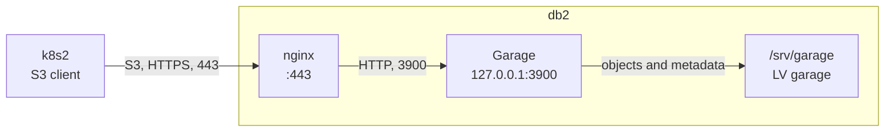

# Object store

db2 runs Garage as a single-node S3 object store on a disk of its own. nginx serves it with TLS on port 443, and the [CloudNativePG backups](../kubernetes/cloudnativepg-backups.md) go to its bucket `pg-backups` at `https://db2/`.

Checks: [33](../../../checks/33-object-store.sh) · Managed by: [Role garage](../ansible/garage.md)

## Setup

### Garage

| Part | Setup |
|---|---|
| Binary | `/usr/local/bin/garage` v2.5.0, the static `x86_64-unknown-linux-musl` build from the Garage releases page |
| User | `garage`, UID and GID 1501, shell `/usr/sbin/nologin`, no home |
| Config | `/etc/garage.toml`, with no secrets in it |
| Metadata | SQLite, with `metadata_fsync` and `data_fsync` on |
| Replication | `replication_factor = 1` |
| Secrets | `/etc/garage/rpc_secret` and `admin_token`, `600 garage:garage`, read through the `_file` options. `/etc/garage` is `750 root:garage`. |
| Data | `/srv/garage/meta` and `/srv/garage/data` on LV `garage` ([VMs, Object store disk](../hosts/vms.md#object-store-disk)). `/srv/garage` is `750 garage:garage`. |
| Service | `/etc/systemd/system/garage.service`, enabled, as `garage`, with `RequiresMountsFor=/srv/garage` |
| Ports | S3 API on `127.0.0.1:3900`, RPC on `127.0.0.1:3901`, admin API on `127.0.0.1:3903` |
| Layout | One node, zone `dc1`, capacity `4G`, layout version 1 |
| Bucket | `pg-backups`, region `garage`, path-style URLs (`https://db2/pg-backups/<key>`) |
| Key | `cnpg`, read and write on `pg-backups`, not an owner. It is the only key on the bucket. |
| CLI | `sudo -u garage /usr/local/bin/garage`, not `-iu` (the shell is `nologin`) |

### TLS with nginx

| Part | Setup |
|---|---|
| Package | `nginx` 1.26.3 from AppStream |
| Certificate | `/etc/pki/tls/certs/db2-s3.crt` (644), `CN=db2` with `DNS:db2` and `IP:192.168.122.12`, from the [lab CA](../postgresql/tls.md#setup), valid to 2029-02-26 |
| Key | `/etc/pki/tls/private/db2-s3.key` (600, `root:root`), EC P-256, no passphrase. It is not the key of PostgreSQL on db2. |
| Site | `/etc/nginx/conf.d/garage.conf`, `listen 443 ssl` for `db2` and `192.168.122.12`, `proxy_pass http://127.0.0.1:3900` |
| Host header | `proxy_set_header Host $http_host`, the header as the client sent it (SigV4 signs it) |
| Body size | `client_max_body_size 0`, no limit (WAL segments are 16 MB) |
| Response buffering | `proxy_max_temp_file_size 0`, so a large GET is not written to a temporary file |
| Service | `nginx` enabled. The default server on port 80 in `/etc/nginx/nginx.conf` stays, and firewalld keeps port 80 closed. |
| Firewall, SELinux | Service `https`, `httpd_can_network_connect` on ([System settings](../hosts/system.md)) |

## Layout

How a request from k8s2 reaches the data:

## Why

- Garage rather than SeaweedFS, because Garage is one small program with a single-node mode, and SeaweedFS needs several services for one node.
- nginx in front for TLS, because Garage serves S3 over plain HTTP. Garage listens only on `127.0.0.1`, so a request from another host always comes through TLS.
- SQLite with both fsyncs on, because the Garage docs warn that LMDB can be corrupted by an unclean shutdown, and a single node has no copy to rebuild from.
- A disk of its own, because VG `data` on db2 has about 2 GiB free, and a full object store cannot fill `/pgdata` or `/srv/backup`.
- `httpd_can_network_connect` rather than `nis_enabled`, which `audit2why` also offered, because `nis_enabled` lets many more services connect to unreserved ports.

## Limits

- One node with `replication_factor = 1`: a lost `vdc` or a lost db2 loses every object. db2 runs on the same NUC as the Kubernetes cluster, so the store protects against the loss of a worker, not of the NUC.
- The bucket has no quota, so the objects can fill `/srv/garage` (5 GiB).

## Tested

| Date | Test | Result |
|---|---|---|
| 2026-11-24 | Requests through nginx before and after `httpd_can_network_connect` | Before: `502`, with `(13: Permission denied)` in `/var/log/nginx/error.log` and an AVC for `name_connect` to port 3900. After: `403` from Garage, for an unsigned request. |
| 2026-11-24 | TLS and signed S3 requests from k8s2 to `https://db2/` and `https://192.168.122.12/` | TLSv1.3 with `Verification: OK`. PUT, list and GET `200` on both names, a 16 MiB PUT `200`, DELETE `204`. Without the lab CA curl stops with `(60) unable to get local issuer certificate`. |
