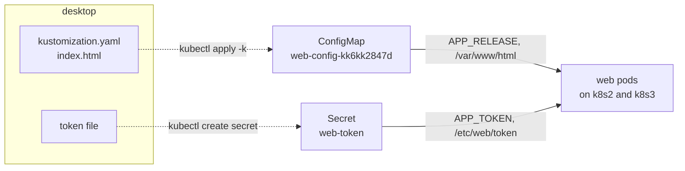

# Kubernetes app settings

The app `web` takes its settings from the ConfigMap `web-config` and the Secret `web-token` in the namespace `web`, as variables and as files. Kustomize generates the ConfigMap from `kubernetes/apps/web/`, and the Secret is made by hand and is not in the repo.

Checks: [28](../../../checks/28-app-settings.sh) · Files: [`kubernetes/apps/web/kustomization.yaml`](../../../kubernetes/apps/web/kustomization.yaml)

## Setup

### Kustomize

| Part | Setup |
|---|---|
| Kustomize | `v5.8.1`, built into `kubectl` 1.36.6 on the desktop |
| `kustomization.yaml` | Namespace `web` for every object, resources `namespace.yaml` and `deployment.yaml` |
| Order | The Namespace first, then the ConfigMap and the Deployment |
| Apply | `kubectl apply -k kubernetes/apps/web/` from the desktop, through the tunnel |

### ConfigMap web-config

| Part | Setup |
|---|---|
| Generator | `configMapGenerator` in `kustomization.yaml`, label `app: web` |
| Name | `web-config-kk6kk2847d` now. Kustomize adds a hash of the content to `web-config`, so every change gives a new name. |
| `APP_RELEASE` | `3`, a literal in `kustomization.yaml`. The container gets it as the variable `APP_RELEASE`. |
| `index.html` | The file `kubernetes/apps/web/index.html`. The volume `page` mounts it as the only file in `/var/www/html`. |

### Secret web-token

| Part | Setup |
|---|---|
| Token file | `~/.lab-secrets/web/token` on the desktop (600, directory 700), 64 hex characters from `openssl rand -hex 32` |
| Secret | `Opaque`, key `token`, 64 bytes |
| Made by | `kubectl create secret generic web-token -n web --from-file=token=$HOME/.lab-secrets/web/token` on the desktop |
| In the container | The variable `APP_TOKEN` and the file `/etc/web/token` (volume `token`, mode 440) |
| Access | The service account `default` in `web` cannot read Secrets. `kubectl auth can-i get secrets -n web` gives `no` for it. |

## Layout

Where the pods get their settings from:

## Why

- Kustomize generates the ConfigMap with a new name on every change, so a settings change rolls out new pods like a new image. With a fixed name, a variable keeps its old value until the pod restarts.
- The Secret is made by hand and stays out of the repo, because base64 in a manifest is an encoding, not encryption.
- The token is mounted in `/etc/web`, outside the DocumentRoot `/var/www/html`, so httpd never serves it.

## Limits

- etcd keeps `web-token` as plain text, because the API server has no encryption at rest. An `etcdctl get` on k8s1 shows the token.
- The Secret is not in the repo, so on a fresh cluster it is made by hand after `kubectl apply -k` has made the namespace. The pods do not start until then.
- `kubectl apply -k` leaves the old generated ConfigMaps in place, so they are deleted by hand. A `kubectl rollout undo` to a revision whose ConfigMap is deleted (now 1 to 9) gives pods that do not start.

## Tested

| Date | Test | Result |
|---|---|---|
| 2026-11-17 | Change of a ConfigMap with a fixed name, mounted as a directory | 53 s until the running pod served the new page. `APP_RELEASE` changed only after `kubectl rollout restart`. |
| 2026-11-17 | New `APP_RELEASE` in `kustomization.yaml`, then `kubectl apply -k` | New ConfigMap `web-config-kk6kk2847d`, a rollout to revision 11 with no restart, `3` in the page and in `APP_RELEASE`. |
| 2026-11-17 | Live change of `APP_RELEASE` to `4`, then a reboot of k8s1, k8s2 and k8s3 | One FAIL in check 28, the pods still on `3`. After `kubectl apply -k` and the reboot, checks 25 to 28 passed. |

## Planned

- Ansible makes `web-token` from Vault on a fresh cluster (item 44).
