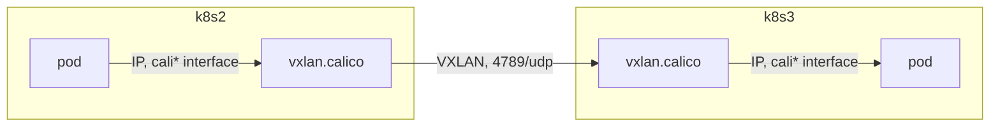

# Calico

Calico v3.33.1 gives every pod an address from `10.244.0.0/16` and carries the traffic between the nodes in VXLAN. The Tigera operator installs it on k8s1, k8s2 and k8s3 and keeps it running.

Checks: [26](../../../checks/26-cluster.sh) · Files: [`kubernetes/calico/custom-resources.yaml`](../../../kubernetes/calico/custom-resources.yaml)

## Setup

| Part | Setup |
|---|---|
| CRDs | 31, from [`v3_projectcalico_org.yaml`](https://raw.githubusercontent.com/projectcalico/calico/v3.33.1/manifests/v3_projectcalico_org.yaml) of v3.33.1 |
| Operator | Tigera operator v1.44.1 in `tigera-operator`, from [`tigera-operator.yaml`](https://raw.githubusercontent.com/projectcalico/calico/v3.33.1/manifests/tigera-operator.yaml) of v3.33.1 |
| Custom resources | `Installation` and `APIServer`, both named `default`, from `kubernetes/calico/custom-resources.yaml` |
| IP pool | `default-ipv4-ippool`, `10.244.0.0/16` (the `podSubnet` of the [Kubernetes cluster](cluster.md#cluster)), blocks of `/26` |
| Encapsulation | VXLAN `Always`, IPIP `Never`, outgoing NAT on |
| BGP | `Disabled` |
| Data plane | `Nftables`, with the tables `ip calico` and `arp calico-arp` |
| Pods | `calico-node` and `csi-node-driver` on every node, `calico-typha` (two, host network), `calico-kube-controllers` and `calico-webhooks` (two), all in `calico-system` |
| CNI config | `/etc/cni/net.d/10-calico.conflist` and `calico-kubeconfig`, root 600, on every node |
| Goldmane, Whisker | Not installed (a technology preview, and the workers have 2.5 GiB each) |

## Layout

A packet from a pod on k8s2 to a pod on k8s3, as in the test below:

## Why

- VXLAN with `bgp: Disabled`, so the nodes run no BGP daemon and need only `4789/udp` between them, not `179/tcp`.
- `linuxDataplane: Nftables`, like kube-proxy in `nftables` mode, because iptables is deprecated on RHEL 10. Both keep their rules in tables of their own (`ip calico`, `ip kube-proxy`) beside `inet firewalld`.
- firewalld stays on, although the Calico docs say to disable it, because the role `base` keeps the firewall of every host. The pod network is in [the zone `trusted`](../hosts/system.md#firewall-on-the-kubernetes-nodes), since firewalld drops traffic forwarded between interfaces in no zone, such as `cali*` and `vxlan.calico`.
- `APIServer` stays, because in 3.33 it runs only `calico-webhooks`, which check Calico resources.
- The upstream manifests go in with `kubectl create`, because `kubectl apply` fails on the `installations` CRD (about 650 KiB). The repo file goes in with `kubectl apply`, so a later change is applied as a diff.

## Limits

- Only the namespace `web` has [network policies](services.md#network-policies), so every pod outside it takes connections from any pod.

## Tested

| Date | Test | Result |
|---|---|---|
| 2026-11-16 | `wget` from a pod on k8s2 to a pod on k8s3, by pod IP | The pod on k8s3 (`10.244.219.2:8080`) answered `smoke-b` to `10.244.109.66` on k8s2, with firewalld on. |
