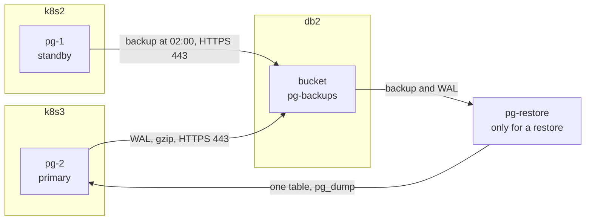

# CloudNativePG backups

plugin-barman-cloud archives the WAL of the [Cluster `pg`](cloudnativepg.md) to the bucket `pg-backups` in the [object store](../backups/object-store.md) on db2, and a schedule backs `pg` up there at 02:00 UTC. A restore to a set time builds a new Cluster beside `pg` from them.

Checks: [34](../../../checks/34-backups.sh) · Files: [`kubernetes/plugin-barman-cloud/values.yaml`](../../../kubernetes/plugin-barman-cloud/values.yaml), [`kubernetes/apps/pg/`](../../../kubernetes/apps/pg/), [`kubernetes/apps/pg-restore/`](../../../kubernetes/apps/pg-restore/)

## Setup

### Plugin

| Part | Setup |
|---|---|
| Chart | `plugin-barman-cloud` 0.9.0 (plugin-barman-cloud v0.16.0) from `https://cloudnative-pg.github.io/charts`, release `plugin-barman-cloud` in `cnpg-system`, with `kubernetes/plugin-barman-cloud/values.yaml` |
| Deployment | `plugin-barman-cloud`, 1 replica |
| Requests | CPU `100m`, memory `100Mi`, no limits (as the operator) |
| Service | `barman-cloud` on `9090/TCP`, with the label `cnpg.io/pluginName=barman-cloud.cloudnative-pg.io` |
| Certificates | `barman-cloud-client` and `barman-cloud-server` from [cert-manager](cert-manager.md), for TLS between the operator and the plugin |
| CRD | `objectstores.barmancloud.cnpg.io` |

### Object store

| Part | Setup |
|---|---|
| ObjectStore | `db2` in `pg`, applied with the Cluster by `kubectl apply -k kubernetes/apps/pg/` |
| Destination | `s3://pg-backups/` at `https://db2`, with path-style URLs. The WAL goes under `pg/wals/` and the backups under `pg/base/`. |
| CA | Secret `lab-ca`, key `ca.crt`, the [lab CA](../postgresql/tls.md#setup) |
| Credentials | Secret `garage-cnpg` with `ACCESS_KEY_ID`, `ACCESS_SECRET_KEY` and `REGION` (`garage`), for the key `cnpg` of the [object store](../backups/object-store.md#garage) |
| Secrets | `garage-cnpg` and `lab-ca`, made by hand from `~/.lab-secrets/garage/` and `~/.lab-secrets/pki/lab-ca.crt` on the desktop |
| Compression | `gzip` for the WAL and the backups |
| Retention | `7d`, a recovery window of 7 days, enforced by the sidecar every 30 min |
| Sidecar resources | Requests equal to the limits: CPU `200m`, memory `256Mi`. The pods of `pg` stay `Guaranteed`. |
| Sidecar settings | `AWS_REQUEST_CHECKSUM_CALCULATION` and `AWS_RESPONSE_CHECKSUM_VALIDATION` set to `when_required` (for S3 stores other than AWS) |

### Cluster pg

| Part | Setup |
|---|---|
| Plugin | `barman-cloud.cloudnative-pg.io` in `spec.plugins`, the WAL archiver (`isWALArchiver: true`) with the ObjectStore `db2` |
| Sidecar | `plugin-barman-cloud` in both instance pods, added by the plugin as a native sidecar in `initContainers` (`restartPolicy: Always`) |
| ScheduledBackup | `pg-nightly`, schedule `0 0 2 * * *` (02:00 UTC, the first field is seconds), `immediate: true`, method `plugin` |
| Instance | The standby, the default when the Cluster sets no backup target |
| Backup by hand | `kubectl cnpg backup pg -n pg --method=plugin --plugin-name=barman-cloud.cloudnative-pg.io` |

### Restore cluster

| Part | Setup |
|---|---|
| Manifests | Cluster `pg-restore` in `pg`, from `kubernetes/apps/pg-restore/`, applied only for a [restore of a table](../../runbooks/restore-a-table-to-a-time-with-cloudnativepg.md) and deleted after it |
| Kustomization | Only `cluster.yaml`, so `kubectl delete -k` leaves the namespace `pg` |
| Instance | 1, with the image, resources and volume size of `pg` |
| Source | The external cluster `origin`, read by the plugin from the ObjectStore `db2` with `serverName: pg` |
| Target | `recoveryTarget.targetTime`, set before each restore. The repo holds the time of the last test. |
| Archiving | None. The Cluster has no `spec.plugins`, so the copy writes nothing to the bucket. |
| Recovery Job | `pg-restore-1-full-recovery` restores the backup and replays the WAL. It and the first instance pod also get the sidecar, 256Mi more while they run. |

## Layout

How the WAL, the backups and a restored table flow, with `pg-2` on k8s3 as the primary:

## Why

- plugin-barman-cloud rather than `barmanObjectStore` in the Cluster, because CloudNativePG deprecated its built-in Barman Cloud support, and the image `18.7-minimal-trixie` does not carry Barman Cloud.
- The plugin from its Helm chart, as the other add-ons of the cluster, so `helm list -A` shows it and all of them upgrade the same way.
- A backup every night with `immediate: true`, so the Cluster had its first backup, and a point to restore to, right after the apply.
- `gzip` for the WAL and the backups, because it is in the Python standard library, so the sidecar needs no extra module.
- A restore into a new Cluster beside `pg`, with one table copied back, so `pg` keeps the writes after the target time and has no outage.

## Limits

- The backups have one copy, in the object store on db2, which runs on the same NUC as the cluster ([Object store, Limits](../backups/object-store.md#limits)).
- Only a table brought back into `pg` is tested. A new Cluster `pg` from the backups, as after the loss of both data disks, is not.
- The lab is often off at 02:00. A missed slot runs once when the operator comes back. On 2026-11-25 that run failed, and its cause is not read ([Tested](#tested)).
- `garage-cnpg` and `lab-ca` are not in the repo, so a fresh cluster needs them before `kubectl apply -k kubernetes/apps/pg/`, as `pg-app` and `pg-report` ([CloudNativePG, Limits](cloudnativepg.md#limits)).
- Not tested after a reboot of the cluster: check 34 ran once, on 2026-11-24, with no negative test.

## Tested

The archive and the backups are read from `kubectl cnpg status pg -n pg` and from `garage bucket info pg-backups` on db2.

| Date | Test | Result |
|---|---|---|
| 2026-11-24 | The plugin added to the Cluster `pg` as its WAL archiver | `pg-1` made again first, then `pg-2` in place on its PVC, with no switchover. `Working WAL archiving: OK`, about 17 kB per switched segment in the bucket. |
| 2026-11-24 | Backups of the standby `pg-1`, one at once by the schedule and one by hand | 13 s and about 4.2 MB each, so about 40 MB for the 7-day window. An idle cluster wrote no WAL in 71 min. |
| 2026-11-24 | Restore of a dropped table to 10 s before its `DROP TABLE` into the Cluster `pg-restore` ([runbook](../../runbooks/restore-a-table-to-a-time-with-cloudnativepg.md)) | Ready 67 s after `kubectl apply -k`, the table back in `pg` by `pg_dump` in 1 s, 5,000 of 5,000 rows, no outage of `pg` |
| 2026-11-25 | The 02:00 slot, missed while the lab was off | `pg-nightly-20261125020000` made at 10:24 UTC, when the cluster came back, and `failed` 48 s later with `exit status 1`. |
