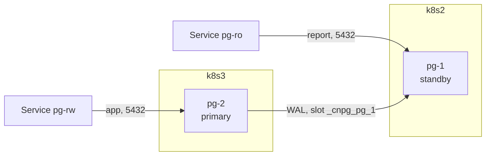

# CloudNativePG

CloudNativePG 1.30.2 runs the PostgreSQL 18 cluster `pg` in the [Kubernetes cluster](cluster.md): a primary on one worker and an asynchronous streaming standby on the other, each on its own [TopoLVM volume](storage.md#topolvm). `pg-2` on k8s3 is the primary, and `pg-1` on k8s2 is its standby.

Checks: [32](../../../checks/32-cloudnativepg.sh), [35](../../../checks/35-etcd-backup.sh), [36](../../../checks/36-upgrade.sh) · Files: [`kubernetes/cnpg/values.yaml`](../../../kubernetes/cnpg/values.yaml), [`kubernetes/apps/pg/`](../../../kubernetes/apps/pg/), [`kubernetes/apps/failover-client/`](../../../kubernetes/apps/failover-client/), [`scripts/failover-client.sh`](../../../scripts/failover-client.sh)

## Setup

### Operator

| Part | Setup |
|---|---|
| Chart | `cloudnative-pg` 0.29.2 (CloudNativePG 1.30.2) from `https://cloudnative-pg.github.io/charts`, release `cnpg` in `cnpg-system`, with `kubernetes/cnpg/values.yaml` |
| Namespace | `cnpg-system`, made by `helm install --create-namespace` |
| CRDs | 11 in `postgresql.cnpg.io`, among them `clusters`, `backups`, `scheduledbackups` and `poolers`. The chart gives them `helm.sh/resource-policy: keep`, so `helm uninstall` keeps them. |
| Operator | Deployment `cnpg-cloudnative-pg`, 2 replicas, one on each worker (required `podAntiAffinity` on `kubernetes.io/hostname`) |
| Leader | One replica holds the Lease `db9c8771.cnpg.io` and manages the clusters. Both answer the webhook calls of the API server. |
| Update strategy | `RollingUpdate` with `maxSurge: 0` and `maxUnavailable: 1` (a third pod has no worker to run on) |
| Requests | CPU `100m`, memory `100Mi`, no limits |
| Webhook certificates | Made by the operator, without cert-manager |
| Plugin | `kubectl cnpg` 1.30.2 on the desktop, from the RPM `cnpg` of the GitHub release (`/usr/local/bin/kubectl-cnpg`) |

### Cluster pg

| Part | Setup |
|---|---|
| Manifests | Namespace `pg` and Cluster `pg`, applied by `kubectl apply -k kubernetes/apps/pg/` |
| Image | `ghcr.io/cloudnative-pg/postgresql:18.7-minimal-trixie` (PostgreSQL 18.7) |
| Instances | 2, `pg-1` on k8s2 and `pg-2` on k8s3 (`podAntiAffinityType: required`) |
| Resources | Requests equal to the limits: CPU `500m`, memory `512Mi`. The pods get the QoS class `Guaranteed`. |
| Settings | `max_wal_size = 256MB`, `wal_keep_size = 128MB` and `max_slot_wal_keep_size = 256MB` in `postgresql.parameters`. The operator sets the rest. |
| Volumes | PVCs `pg-1` and `pg-2`, 1Gi each on the StorageClass `topolvm` (room in VG `data` for the [restore cluster](cloudnativepg-backups.md#restore-cluster)) |
| Replication | Asynchronous streaming. The primary keeps a slot named after the standby (`_cnpg_pg_1` for `pg-1`), made by the operator. |
| Instance roles | Label `cnpg.io/instanceRole` on each pod, `primary` or `replica`, set by the operator |
| Database | `app`, owner `app`, from `bootstrap.initdb` |
| Role `app` | Owner of `app`, its password from the Secret `pg-app` |
| Role `report` | `LOGIN`, member of `pg_read_all_data`, from `managed.roles`, its password from the Secret `pg-report` |
| Secrets | `pg-app` and `pg-report`, type `kubernetes.io/basic-auth` with the label `cnpg.io/reload=true`, made by hand from `~/.lab-secrets/pg/` on the desktop |
| Services | `pg-rw` to the primary, `pg-ro` to the standby and `pg-r` to both, made by the operator, port 5432 |
| Disruption budget | PodDisruptionBudget `pg-primary` only, 0 disruptions allowed. The operator makes no budget for the standby with 2 instances. |
| Drain | A drain of the worker with the primary makes the operator switch over to the standby first, then the eviction goes on. |
| Backups | WAL archive and a backup every night to db2 ([CloudNativePG backups](cloudnativepg-backups.md)) |

### Failover client

| Part | Setup |
|---|---|
| Pod | `failover-client` in `pg`, from `kubernetes/apps/failover-client/`, with the image of the cluster and `restartPolicy: Never` |
| Use | Applied by `kubectl apply -k` only for a test, deleted after it with `kubectl delete -k` |
| Script | `scripts/failover-client.sh` on `/scripts`, from the ConfigMap `failover-client`. The ConfigMap is made by hand with `kubectl create configmap --from-file` and deleted after the test. |
| Writes | One row every 0.2 s with `INSERT … DEFAULT VALUES RETURNING id, server`. Each try prints one line with the time and `ok <id>\|<server>`, or `FAIL` and the error. |
| Script settings | `FAILOVER_CONNINFO`, by default db1 and db2 on port 5433 with `target_session_attrs=read-write`, and `FAILOVER_TABLE`, by default `failover_test` |
| Pod settings | `FAILOVER_CONNINFO=host=pg-rw dbname=app user=app connect_timeout=2`, `FAILOVER_TABLE` set to the table of the test, the password from the Secret `pg-app` |
| Placement | Never on the worker of the primary (required `podAntiAffinity` on `kubernetes.io/hostname`) |
| Resources | Requests CPU `50m` and memory `32Mi`, limits CPU `200m` and memory `64Mi` |
| Test tables | `failover_test`, `etcd_restore_test` and `upgrade_test` in `app`, owner `app`, one per test. Each has `id` (identity), `ts` (`clock_timestamp()`) and `server` (`inet_server_addr()`). |

## Layout

How the logins and the WAL reach the instances, with `pg-2` on k8s3 as the primary:

## Why

- Two operator replicas, one on each worker, so an operator still runs to promote the standby when either worker is lost.
- `podAntiAffinityType: required`, because the default `preferred` can put both instances on one worker, and the failure of that worker then stops both.
- The image `18.7-minimal-trixie`, not the default `system` image, because `system` is deprecated and carries Barman Cloud, which [plugin-barman-cloud](cloudnativepg-backups.md) replaces.
- Lower WAL limits than the defaults of the operator (`wal_keep_size = 512MB` and no cap on the slots), because a volume has only 1Gi, and a long standby outage would fill the volume of the primary.
- The failover client has its own folder, so `kubectl apply -k kubernetes/apps/pg/` never starts it. Its script comes from a ConfigMap made by hand, because Kustomize reads no file outside its folder, and it stays in `scripts/` for the client on db2 ([Streaming replication](../postgresql/replication.md#setup)).

## Limits

- While a worker is down, the cluster runs on one instance with no standby, because each volume lives on one worker. A pod on a stopped worker is evicted after 300 s and comes back only with its worker.
- Replication is asynchronous, so a failover loses the commits the standby has not received yet. The test lost none, but it wrote only about 3.4 rows a second.
- A drain right after a switchover can evict the `pg` pod that the switchover has just restarted. The pod then stays `Terminating` for the grace period of 1800 s, longer than the drain timeout, so the drain is run again after it ([Upgrade the Kubernetes cluster](../../runbooks/upgrade-the-kubernetes-cluster.md)).
- The Secrets are not in the repo, so on a fresh cluster they are made by hand between the namespace and the Cluster (`kubectl apply -f kubernetes/apps/pg/namespace.yaml` first).

## Tested

The outage is read from the log of the client, and the lost rows from its table: the `server` column of `failover_test`, and the `ok` ids in the log that have no row in `etcd_restore_test` or `upgrade_test`. A table holds more rows than its log, because the client writes on until it is deleted.

| Date | Test | Result |
|---|---|---|
| 2026-11-23 | Failover: k8s2, the worker of the primary `pg-1`, powered off with `virsh destroy` while the client wrote through `pg-rw` | 72.9 s without writes, `pg-2` promoted 68 s after the power off. None of the 658 rows that `pg-1` confirmed was lost. |
| 2026-11-23 | Return of k8s2 about 14 min after the power off | `pg-1` back as the standby of `pg-2` on timeline 2, lag 0. The operator ran `pg_rewind` in a new pod on the same PVC, made after the 300 s eviction. |
| 2026-11-23 | Reboot of k8s1, k8s2 and k8s3 at once (`ansible.builtin.reboot`) | Nodes back in 48 to 61 s, `pg-2` still the primary with a new pod IP, 417 MiB `available` on k8s1. Checks 25 to 32 passed. |
| 2026-11-25 | Writes through `pg-rw` while etcd was restored on k8s1 ([runbook](../../runbooks/restore-etcd-from-a-snapshot.md)) | 0 FAIL in the 2,248 inserts of the log, longest gap 0.417 s, all 2,372 rows in `etcd_restore_test`. `pg-2` stayed the primary while the [API server was down](etcd-backup.md#tested). |
| 2026-11-25 | Drain of k8s3, the worker of the primary `pg-2`, in the upgrade to 1.36.7 ([runbook](../../runbooks/upgrade-the-kubernetes-cluster.md)) | 20.3 s without writes, 29 FAIL, 0 rows lost. The operator switched over to `pg-1` on timeline 3. |
| 2026-11-25 | Drain of k8s2, the worker of the primary `pg-1`, in the same upgrade | 20.1 s without writes, 32 FAIL, 0 rows lost. `pg-2` became the primary again on timeline 4, and `upgrade_test` holds 10,174 rows with ids 1 to 10,226. |
