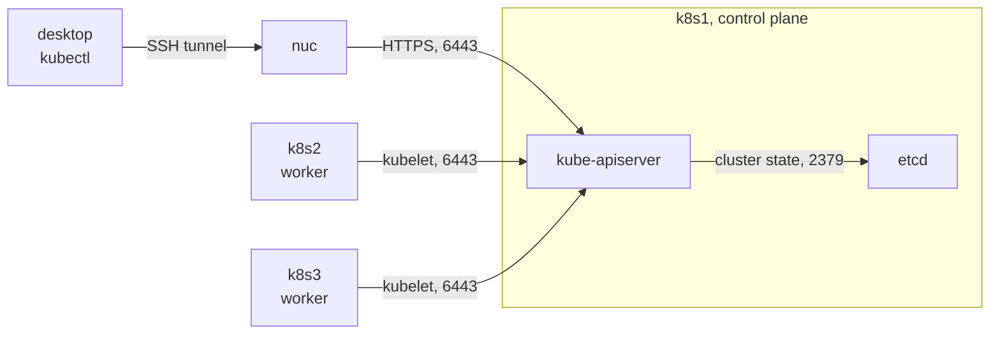

# Kubernetes cluster

kubeadm builds the Kubernetes 1.36.6 cluster from `kubernetes/kubeadm/config.yaml`, with k8s1 as the control plane and k8s2 and k8s3 as workers. [Calico](calico.md) connects the pods, and `kubectl` on the desktop reaches the API server through an SSH tunnel over the nuc.

Checks: [26](../../../checks/26-cluster.sh) · Files: [`kubernetes/kubeadm/config.yaml`](../../../kubernetes/kubeadm/config.yaml)

## Setup

### Cluster

| Part | Setup |
|---|---|
| Version | `v1.36.6` (`kubernetesVersion`), the version of the locked packages |
| Container runtime | CRI-O 1.36.8 on `unix:///var/run/crio/crio.sock` |
| Cgroup driver | `systemd` in the kubelet config, the same as CRI-O |
| Pod network | `10.244.0.0/16` (`podSubnet`), the same as the [Calico](calico.md) pool |
| `kube-proxy` | `mode: nftables` |
| API server certificate | The default names of kubeadm and `127.0.0.1` (`certSANs`) |

### Nodes

| Part | k8s1 | k8s2, k8s3 |
|---|---|---|
| Role | Control plane | Worker |
| Built by | `kubeadm init --config`, with `--skip-token-print` | `kubeadm join`, with a token from `kubeadm token create --ttl 1h --print-join-command` on k8s1 |
| API server | `192.168.122.21:6443` (`advertiseAddress`) | None |
| Static pods | `etcd`, `kube-apiserver`, `kube-controller-manager` and `kube-scheduler` in `/etc/kubernetes/manifests/` | None |
| Taint | `node-role.kubernetes.io/control-plane:NoSchedule` (the [app pods](workloads.md) run on the workers) | None |
| Admin kubeconfig | `~/.kube/config` of `makilele`, mode 600 | None |

### Access from the desktop

| Part | Setup |
|---|---|
| Client | `kubectl` 1.36.6 from the Fedora package `kubernetes1.36-client` |
| Helm | `helm` 4.2.2 from the Fedora package `helm`, for the charts of [MetalLB](metallb.md) and [Traefik](gateway.md#traefik) |
| Tunnel | `ssh -N -L 6443:192.168.122.21:6443 nuc` in a second terminal (the desktop has no route to `192.168.122.0/24`) |
| Kubeconfig | `~/.kube/config`, mode 600, in `~/.kube` with mode 700. It is the admin kubeconfig of k8s1 with `server: https://127.0.0.1:6443`. |

## Layout

The way to the API server, from the desktop and from the workers:

## Why

- [kubeadm with CRI-O](../../decisions/kubeadm-with-cri-o.md), because each part of the control plane is a static pod on k8s1 that can be read, backed up and upgraded on its own.
- `podSubnet` is `10.244.0.0/16`, because the default Calico pool `192.168.0.0/16` overlaps the lab networks `192.168.1.0/24` and `192.168.122.0/24`.
- `kubernetesVersion` is fixed, so a rebuild gets the version of the locked packages. Without it, kubeadm looks up the newest release online (1.37.2) and falls back to the newest 1.36 patch.
- `certSANs` adds `127.0.0.1`, which the default names of kubeadm do not have, so the desktop kubeconfig differs from the admin kubeconfig only in `server:`.
- The join tokens are deleted after the joins, because a valid token lets any host on the network join the cluster as a node.

## Limits

- k8s1 is the only control plane node and runs the only etcd, so the API server is down while k8s1 restarts, and etcd has no backup yet.
- `kubectl` and `helm` on the desktop work only while the tunnel runs. A reboot of k8s1 does not close it, because the tunnel ends on the nuc.
- No role or playbook builds the cluster. A rebuilt node needs `kubeadm init` or `kubeadm join` by hand.

## Tested

| Date | Test | Result |
|---|---|---|
| 2026-11-16 | Reboot of k8s1, k8s2 and k8s3 at once (`ansible.builtin.reboot`) | `elapsed` 44 s on k8s1, 19 s on k8s2 and k8s3. All three nodes and 21 pods became `Ready`, and checks 25 and 26 passed. |

## Planned

- An etcd snapshot every night and a timed restore (item 35).
- The upgrade one node at a time while PostgreSQL stays up (item 36).
