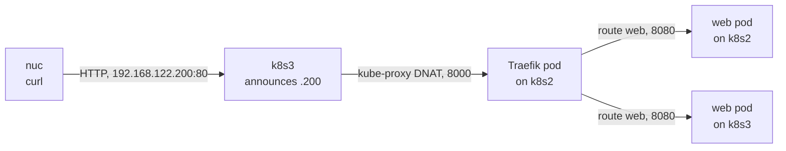

# Kubernetes gateway

Traefik 3.7.19 is the Gateway API controller of the [Kubernetes cluster](cluster.md), one pod on a worker. Its Gateway `traefik-gateway` takes HTTP on `192.168.122.200:80`, an address from [MetalLB](metallb.md), and the HTTPRoute `web` sends every request to the [Service `web`](services.md#service-web).

Checks: [30](../../../checks/30-outside.sh) · Files: [`kubernetes/traefik/values.yaml`](../../../kubernetes/traefik/values.yaml), [`kubernetes/apps/web/httproute.yaml`](../../../kubernetes/apps/web/httproute.yaml)

## Setup

### Gateway API

| Part | Setup |
|---|---|
| CRDs | 10 of the standard channel v1.6.3 (the version Traefik 3.7 supports), from [`standard-install.yaml`](https://github.com/kubernetes-sigs/gateway-api/releases/download/v1.6.3/standard-install.yaml) with `kubectl apply --server-side` |
| Admission policy | ValidatingAdmissionPolicy `safe-upgrades.gateway.networking.k8s.io` and its binding, from the same file |

### Traefik

| Part | Setup |
|---|---|
| Chart | `traefik` 42.4.1 from `https://traefik.github.io/charts`, release `traefik` in `traefik`, with `kubernetes/traefik/values.yaml` |
| Namespace | `traefik`, made by `helm install --create-namespace` |
| Image | `docker.io/traefik:v3.7.19` |
| Pod | One, of the Deployment `traefik`, with the labels `app.kubernetes.io/name: traefik` and `app.kubernetes.io/instance: traefik-traefik` |
| Gateway provider | `providers.kubernetesGateway.enabled: true` (off in the chart) |
| Entrypoint | `web` on 8000 in the pod. `websecure` is not exposed (no certificate). |
| Service | `traefik`, `LoadBalancer` on `192.168.122.200`, port 80 to `web` only |
| Address | Fixed by the annotation `metallb.io/loadBalancerIPs: 192.168.122.200` in `service.annotations` |

### Gateway

| Part | Setup |
|---|---|
| GatewayClass | `traefik`, controller `traefik.io/gateway-controller`, made by the chart |
| Gateway | `traefik-gateway` in `traefik`, made by the chart, address `192.168.122.200` |
| Listener | `web`, HTTP on 8000 (the entrypoint port, not the Service port 80) |
| Allowed routes | `from: Selector` on `kubernetes.io/metadata.name: web` (the default `from: Same` allows only `traefik`) |

### HTTPRoute web

| Part | Setup |
|---|---|
| Namespace | `web`, applied with the app by `kubectl apply -k kubernetes/apps/web/` |
| Parent | Gateway `traefik-gateway` in `traefik`, `sectionName: web` |
| Rule | One, with no hostnames or matches, so the default `PathPrefix /` takes every request on the listener. |
| Backend | Service `web`, port 80. Traefik reads its endpoints and connects to the pods on 8080, which [`allow-gateway`](services.md#network-policies) lets in. |

## Layout

A request from the nuc to the web pods, as check 30 sends it:

## Why

- Traefik is the Gateway controller, because it runs as one pod and also serves Ingress. Envoy Gateway runs a controller and one Envoy pod per Gateway, on workers with 2.5 GiB each.
- The Gateway API CRDs go in with `kubectl apply --server-side`, as the Gateway API guide does. The standard HTTPRoute CRD is about 237 KiB, close to the 256 KiB limit of the annotation that a client-side `apply` writes, and the experimental one is over it.
- The GatewayClass and the Gateway come from the chart (`gatewayClass.enabled` and `gateway.enabled` are on by default), so their settings are in `values.yaml` with the rest of Traefik.
- The address is fixed by the annotation, so a reinstall of the chart keeps `192.168.122.200`.

## Limits

- The Gateway serves HTTP only, with no certificate, so the page crosses the lab network in plain text.
- One Traefik pod, so the Gateway stops while that pod restarts or moves to another worker.
- `kubectl apply -k kubernetes/apps/web/` prints `configured` for the route on every run, though nothing changes, so `kubectl diff -k` is the proof that the cluster matches the repo.

## Tested

| Date | Test | Result |
|---|---|---|
| 2026-11-19 | `curl` to `http://192.168.122.200/` from the nuc, before and after `allow-gateway` | `504` after 30 s without it (the dial timeout of Traefik), `200` in 2 ms with it |
| 2026-11-19 | Route `sectionName` patched to `http`, then a reboot of k8s1, k8s2 and k8s3 | Three FAIL in check 30 (the route not `Accepted`, `404` at once). After `kubectl apply -k` and the reboot, checks 25 to 30 passed, and k8s3 still announced `.200`. |
