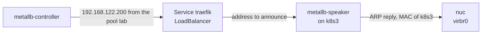

# MetalLB

MetalLB v0.16.2 gives each Service of type `LoadBalancer` an address from `192.168.122.200` to `.209` on the libvirt network `default`, and one worker answers ARP for it. The [Service `traefik`](gateway.md#traefik) has `192.168.122.200`.

Checks: [30](../../../checks/30-outside.sh) · Files: [`kubernetes/metallb/`](../../../kubernetes/metallb/)

## Setup

| Part | Setup |
|---|---|
| Chart | `metallb` 0.16.2 from `https://metallb.github.io/metallb`, with its CRDs, release `metallb` in `metallb-system` |
| Values | `frrk8s.enabled: false` in `kubernetes/metallb/values.yaml`, so no FRR-K8s pods |
| Namespace | `metallb-system`, made by `helm install --create-namespace`, with no Pod Security labels |
| Controller | Deployment `metallb-controller`, one pod. It gives the Services their addresses. |
| Speaker | DaemonSet `metallb-speaker`, one pod with one container on every node, on the host network |
| Address pool | IPAddressPool `lab`, `192.168.122.200-192.168.122.209`, from `kubernetes/metallb/ipaddresspool.yaml` |
| Announcement | L2Advertisement `lab` for the pool `lab`, from `kubernetes/metallb/l2advertisement.yaml` |
| Repo resources | `kubectl apply -k kubernetes/metallb/`, after the chart, whose CRDs they need |
| Announcing node | k8s2 or k8s3, one node per address. k8s1 has the label `node.kubernetes.io/exclude-from-external-load-balancers` from kubeadm. |
| Firewall | The [speakers' port](../hosts/system.md#firewall-on-the-kubernetes-nodes) on every node |

## Layout

How the Service `traefik` gets its address, and how the nuc finds the node behind it:

## Why

- L2 mode with `frrk8s.enabled: false`, because the chart's default FRR-K8s backend runs FRR for BGP on every node, and the lab network has no BGP router.
- The pool is outside the [DHCP range](../hosts/nuc.md#virtualization) of `default`, so libvirt never leases an address that MetalLB gives out.
- `metallb-system` has no Pod Security labels, because MetalLB asks for them only in a cluster that enforces pod security, and this cluster sets no level yet.

## Limits

- The addresses are on the NAT network of the nuc, so the nuc and the VMs reach them, and the desktop and the home network do not.
- One node answers ARP for an address, so all traffic to `.200` enters through k8s3. The move to k8s2 when k8s3 stops is not measured yet.

## Tested

| Date | Test | Result |
|---|---|---|
| 2026-11-18 | Service `probe` of type `LoadBalancer` in the namespace `lb-test`, `curl` from the nuc | `192.168.122.200` from the pool `lab`, announced by k8s3 (`52:54:00:00:00:23` in `ip neigh` on the nuc), `200` |
