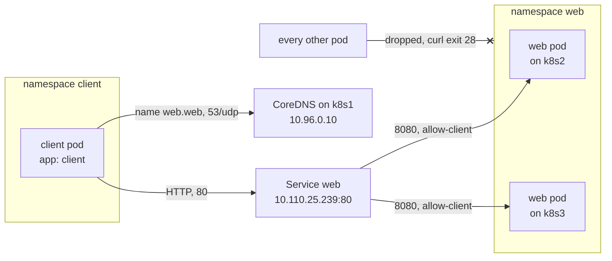

# Kubernetes services and network policies

The Service `web` gives the two web pods one address, `10.110.25.239`, and the DNS name `web.web` inside the cluster. Two network policies in the namespace `web` let in only the [client pod](workloads.md#deployment-client) from the namespace `client`.

Checks: [29](../../../checks/29-in-cluster.sh) · Files: [`kubernetes/apps/web/`](../../../kubernetes/apps/web/)

## Setup

### Service web

| Part | Setup |
|---|---|
| Type | `ClusterIP`, `10.110.25.239` |
| Selector | `app: web`, the two pods of the [Deployment `web`](workloads.md#deployment-web) |
| Port | `http` 80 to `targetPort: http`, the container port 8080 |
| Endpoints | One EndpointSlice with two ready endpoints on 8080, one per web pod |
| `kube-proxy` | [`nftables` mode](cluster.md#cluster). The chain `service-KBN4SH2Y-web/web/tcp/http` sends each new connection to one of the two endpoints at random. |

### DNS

| Part | Setup |
|---|---|
| CoreDNS | Two pods with the Corefile of kubeadm, both on k8s1, behind the Service `kube-dns` on `10.96.0.10` |
| Resolver in the pods | `nameserver 10.96.0.10` and the search list `client.svc.cluster.local svc.cluster.local cluster.local` in the client |
| Names of web | `web.web.svc.cluster.local` and `web.web` resolve to `10.110.25.239` from the client. `web` alone resolves only in the namespace `web`. |

### Network policies

| Part | Setup |
|---|---|
| Kind | `NetworkPolicy` of `networking.k8s.io/v1`, enforced by [Calico](calico.md). Calico's own `projectcalico.org` kind is not used. |
| `default-deny-ingress` | `podSelector: {}` and `policyTypes: [Ingress]` with no rules, so every pod in `web` is isolated for incoming traffic. |
| `allow-client` | Selects the pods `app: web` and lets in one source: the namespace `client` and the label `app: client` in one `from` element. |
| Port in `allow-client` | `http` (8080, the named port of the pod) over TCP, not the Service port 80 |

## Layout

How the client reaches the web pods, and where every other pod stops:

## Why

- The Service is `ClusterIP`, because only pods in the cluster use the app. A NodePort Service answered on every node, k8s1 too, although k8s1 has no NodePort range open in firewalld.
- `targetPort` and the port in `allow-client` use the name `http`, so a new container port is changed only in `deployment.yaml`.
- `default-deny-ingress` stays beside `allow-client` as the net for pods that no other policy selects. `allow-client` alone already isolates the pods `app: web`, because any policy that selects a pod for Ingress isolates it.
- One `from` element holds both selectors, so a pod needs the namespace `client` and the label `app: client` together. Two elements would let in every pod of the namespace `client`.
- The policies limit only Ingress, because the item lets one client in. An Egress deny would also need a rule for DNS to CoreDNS.

## Limits

- Both CoreDNS pods run on k8s1, so no name in the cluster resolves while k8s1 is down.
- Any pod with the label `app: client` in `client` gets in, so anyone who can make pods there reaches `web`. A pod made by hand with the label got `200`.
- No policy limits Egress, so a web pod can still open connections to any other pod.

## Tested

| Date | Test | Result |
|---|---|---|
| 2026-11-17 | NodePort Service `web-nodeport` (`80:32511/TCP`) before the policies, `curl` from the nuc | The page from `192.168.122.22:32511` (k8s2) and `192.168.122.21:32511` (k8s1). k8s1 has no NodePort range open in firewalld. |
| 2026-11-17 | `curl` to `http://web.web` from the client, from a pod with `app=tester` in `client` and from a pod with `app=client` in `default` | `200` for the client, curl exit 28 after 5 s for the other two. Before the policies, the pod in `default` got `200` too. |
| 2026-11-17 | Port of `allow-client` patched to 8081, then a reboot of k8s1, k8s2 and k8s3 | One FAIL in check 29 (the client got no page). After `kubectl apply -k` and the reboot, checks 25 to 29 passed. |

## Planned

- An address on the lab network from MetalLB, and a Gateway API route from outside the cluster (item 30).
