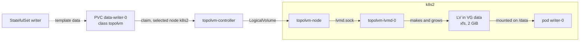

# Kubernetes storage

TopoLVM 0.42.1 makes a thick LV in VG `data` on k8s2 or k8s3 for every PersistentVolumeClaim of the StorageClass `topolvm`, the default class of the [Kubernetes cluster](cluster.md). The StatefulSet `writer` runs one pod on each worker, each with its own volume: 2Gi on k8s2 and 1Gi on k8s3. The [PostgreSQL cluster `pg`](cloudnativepg.md#cluster-pg) has a 1Gi volume on each worker too.

Checks: [31](../../../checks/31-storage.sh) · Files: [`kubernetes/topolvm/values.yaml`](../../../kubernetes/topolvm/values.yaml), [`kubernetes/apps/writer/`](../../../kubernetes/apps/writer/)

## Setup

### TopoLVM

| Part | Setup |
|---|---|
| Chart | `topolvm` 17.3.1 (TopoLVM 0.42.1) from `https://topolvm.github.io/topolvm`, release `topolvm` in `topolvm-system`, with `kubernetes/topolvm/values.yaml` |
| Namespace | `topolvm-system`, made by `helm install --create-namespace` |
| CRD | `logicalvolumes.topolvm.io`, one LogicalVolume per volume, with the annotation `helm.sh/resource-policy: keep` from `crd.annotations` |
| Controller | Deployment `topolvm-controller`, one pod (`controller.replicaCount: 1`, the chart has two). It makes and grows the volumes. |
| LVM daemon | DaemonSet `topolvm-lvmd-0` (lvmd), one pod on each worker. It runs the host's `lvm` through `nsenter`, so the host's LVM devices file applies. |
| Node plugin | DaemonSet `topolvm-node`, one pod on each worker. It asks lvmd for the LVs over `/run/topolvm/lvmd.sock` and mounts them. |
| Placement | k8s2 and k8s3. No TopoLVM pod has a toleration for the [control-plane taint](cluster.md#nodes) of k8s1, which has no data disk. |
| Device class | `data` on VG `data`, the default class, thick LVs (`type: thick`, the default, written out), `spare-gb: 0` |
| Snapshots | Off (`snapshot.enabled: false`), because TopoLVM makes snapshots only of thin LVs |
| Capacity | One CSIStorageCapacity per worker, equal to the free space of VG `data` (5116Mi with no volumes) |
| Volume names | `pvc-` and the UID of the PVC, for the PV and its LogicalVolume. The LV in VG `data` is named after the volume handle of the PV. |
| Node affinity | `topology.topolvm.io/node` in each PV, so its pod runs only on the worker of its LV |

### StorageClass topolvm

The `storageClasses` list in the values replaces the chart's list whole, so it repeats the binding mode and the expansion of the chart's class.

| Part | Setup |
|---|---|
| Name | `topolvm`, from `storageClasses` in `kubernetes/topolvm/values.yaml` |
| Default | The only class and the default (`isDefaultClass: true`), so a PVC with no `storageClassName` gets it |
| Provisioner | `topolvm.io` |
| File system | `xfs` (`fsType`) |
| Binding | `WaitForFirstConsumer`, so TopoLVM makes the LV on the worker the scheduler picks for the pod |
| Expansion | `allowVolumeExpansion: true` |
| Reclaim policy | `Delete`, so the LV goes with its PVC |

### StatefulSet writer

| Part | Setup |
|---|---|
| Namespace | `writer`, applied with the app by `kubectl apply -k kubernetes/apps/writer/` |
| Service | `writer`, headless (`clusterIP: None`), selector `app: writer`, no ports (the pods listen on nothing) |
| Image | The image of the [Deployment `web`](workloads.md#deployment-web), which runs as uid 1001 |
| Replicas | 2, `writer-0` on k8s2 and `writer-1` on k8s3 |
| Placement | Required `podAntiAffinity` on `kubernetes.io/hostname`, because the default spread only prefers different nodes |
| Container | `writer`, a shell loop that appends the UTC time to `/data/log.txt` every 5 s |
| Requests | CPU `10m`, memory `16Mi` |
| Limits | CPU `100m`, memory `64Mi` |
| File system group | `fsGroup: 1001`, so uid 1001 can write to a new volume, whose root belongs to root |
| Volume template | `data`, `ReadWriteOnce`, 1Gi, with `storageClassName: topolvm` written out |
| Volumes | `data-writer-0` 2Gi on k8s2, `data-writer-1` 1Gi on k8s3 |

## Layout

How the claim of `writer-0` became an LV on k8s2 and a file system in the pod:

## Why

- [TopoLVM with thick LVs](../../decisions/topolvm-with-thick-lvs.md), because a volume must grow while its pod runs, and local-path-provisioner ignores the size of a volume.
- `spare-gb: 0`, because the chart's default keeps 10 GiB free in the VG, more than the 5 GiB of VG `data`, and Kubernetes would see no space on either worker.
- No webhook and no cert-manager for TopoLVM, because chart 17.3.1 makes them only with `webhook.podMutatingWebhook.enabled`, which only `topolvm-scheduler` needs.
- The CRD has `helm.sh/resource-policy: keep`, because the chart has it in `templates/`, and `helm uninstall` would delete it with every LogicalVolume.

## Limits

- The two VGs offer Kubernetes 5116Mi each, but the data disks are thin qcow2 images in the pool `default` on the nuc, which they share with every system disk and the object store disk of db2. When the pool fills, the VMs that write to it pause.
- A volume lives on one worker. Its pod cannot start while that worker is down, and the data is lost with that worker's data disk.
- One controller pod, so no volume is made, grown or deleted while it restarts. Pods with volumes keep running.
- `topolvm-node` restarts when it starts before `topolvm-lvmd-0` on the same worker has made `/run/topolvm/lvmd.sock` (twice in its first minute on k8s3), so check 31 asks for Ready pods, not for 0 restarts.
- TopoLVM can leave an LV behind when a PVC is deleted right after it is made ([TopoLVM limitations](https://github.com/topolvm/topolvm/blob/main/docs/limitations.md)), so check 31 compares the LVs in VG `data` with the PVs both ways.
- `volumeClaimTemplates` cannot be changed, so the repo keeps 1Gi, and the 2Gi of `data-writer-0` lives only in its PVC. A cluster built again from the repo gives both pods 1Gi.

## Tested

| Date | Test | Result |
|---|---|---|
| 2026-11-20 | `data-writer-0` patched from 1Gi to 2Gi while `writer-0` ran | `2.0G` in `df` in the pod and `2.00g` in `lvs` on k8s2 within about 1 s, `RESTARTS 0`, no gap in the lines every 5 s. A new `writer-0` after `kubectl delete pod` had the same log and 2.0G. |
