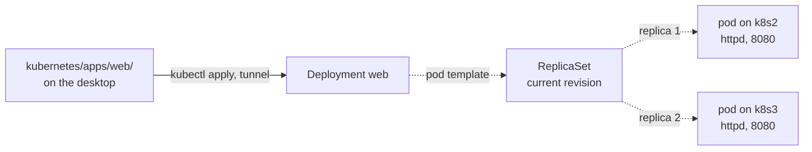

# Kubernetes workloads

The Deployment `web` in the namespace `web` runs two httpd pods on the workers of the [Kubernetes cluster](cluster.md), with health checks and CPU and memory limits. Its files are in `kubernetes/apps/web/`, and `kubectl apply` from the desktop puts them on the cluster.

Checks: [27](../../../checks/27-deployment.sh) · Files: [`kubernetes/apps/web/`](../../../kubernetes/apps/web/)

## Setup

### Deployment web

| Part | Setup |
|---|---|
| Namespace | `web` |
| Image | `registry.access.redhat.com/ubi10/httpd-24:10.3-1793879148`, httpd 2.4.63 on UBI 10 |
| Replicas | 2, on k8s2 and k8s3 (k8s1 has the [control-plane taint](cluster.md#nodes)) |
| Container | `httpd`, port `http` on 8080 |
| Requests | CPU `50m`, memory `64Mi` |
| Limits | CPU `250m`, memory `128Mi` |
| Readiness probe | `httpGet` on `/.noindex.html`, port `http`, every 5 s |
| Liveness probe | `httpGet` on `/.noindex.html`, port `http`, every 10 s |
| Rollout | `RollingUpdate` with `maxSurge: 1` and `maxUnavailable: 0` |
| Progress deadline | `progressDeadlineSeconds: 120` |
| Change cause | `kubernetes.io/change-cause: httpd 10.3-1793879148`, the CHANGE-CAUSE in `kubectl rollout history` |

## Layout

The way from the files in the repo to the pods on the workers:

## Why

- Both probes ask for `/.noindex.html`, because `/` answers `403` on an empty document root, and an HTTP probe checks httpd itself, not only its port.
- The memory request is about four times what idle httpd uses (17 MB), and each limit is twice its request, so httpd has room to start child processes under load.
- `maxSurge: 1` and `maxUnavailable: 0` are written out (the default for two replicas), so a rollout starts one new pod and stops an old one only when the new one is Ready.
- `progressDeadlineSeconds` is 120 instead of the default 600, because that is long enough for an image pull over Wi-Fi (7.1 s for the first one) and shows a stalled rollout in two minutes.
- The image has a build tag, not `10.3` or `latest`, so every pod runs the same build and a new version is a change in `deployment.yaml`.

## Limits

- No Service points at the pods yet, so no client uses httpd, and a rollout without an outage is seen only in the Ready pods, not measured from a client.
- On a fresh cluster, `kubectl apply -f kubernetes/apps/web/` reads `deployment.yaml` before `namespace.yaml`, so the Deployment fails with `namespaces "web" not found`. Apply `namespace.yaml` on its own first.
- `kubectl rollout undo` changes only the live Deployment. After a bad version from the file, `kubectl diff -f kubernetes/apps/web/` shows the difference until the file is fixed and applied again.
- The Calico and `kube-proxy` pods set no requests, so the scheduler does not count the 170–230 MB they use on each worker out of its `2088280Ki` (1.99 GiB) allocatable.
- Nothing keeps the two pods on different workers, so both can end up on one worker and stop together with it.

## Tested

| Date | Test | Result |
|---|---|---|
| 2026-11-16 | Rolling update from httpd `10.2-1794215538` to `10.3-1793879148` | 2 new pods, the second 9 s after the first. The old pods stopped only after the new ones were Ready. |
| 2026-11-16 | Update with a readiness probe that fails (`/healthz`), then `kubectl rollout undo` | New pod `0/1`, the two old pods `1/1`, `ProgressDeadlineExceeded` after 120 s. The undo went back to the old ReplicaSet with no new pods. |
| 2026-11-16 | Reboot of k8s1, k8s2 and k8s3 at once (`ansible.builtin.reboot`) | Both pods `1/1` with the same names, nodes and IPs, `RESTARTS 1`. Checks 25, 26 and 27 passed. |

## Planned

- Settings from a ConfigMap and a Secret, and Kustomize builds the app from its files (item 28).
- A Service with a DNS name and a network policy for the app (item 29).
- Affinity rules that decide where the pods run (item 36).
- Argo CD applies the app from this repo and undoes a change by hand (item 42).
