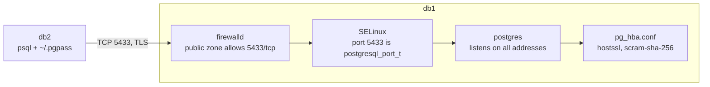

# PostgreSQL server

PostgreSQL 18 runs on db1 as the primary and on db2 as a read-only standby, both on port 5433 with their data on `/pgdata`. Every login from another host uses TLS.

Checks: [06](../../../checks/06-postgres.sh), [07](../../../checks/07-postgres-remote.sh) · Managed by: [Role postgresql](../ansible/postgresql.md)

## Setup

The setup is the same on db1 and db2.

| Part | Setup |
|---|---|
| Package | `postgresql18-server` and `postgresql18-contrib` (for `pg_waldump`) from AppStream, `openssl` for the role's TLS check |
| Service | `postgresql`, enabled. Drop-in `postgresql.service.d/override.conf` with `PGDATA=/pgdata/pgsql/data` and `RequiresMountsFor=/pgdata`. |
| Settings | `postgresql.conf` from the role's template, with `port = 5433`, `listen_addresses = '*'`, `log_line_prefix`, the archive settings and the TLS settings from `ansible/inventory/group_vars/db.yml` |
| `pg_hba.conf` | From the role's template, the same on both hosts: the `initdb` lines, then `hostssl` lines with `scram-sha-256` |
| `hostssl` lines | `remote_test` from db2 to `postgres` and `lab`, `replicator` and `rewind` from db1 and db2, `app` and `report` from db2 to `app` |
| SELinux, firewall | Rules for `/pgdata` and port 5433, `5433/tcp` open ([System settings](../hosts/system.md)) |
| Logs | `/pgdata/pgsql/data/log/postgresql-<day>.log`, each line with the time, the PID and `user@database` |
| Admin access | `sudo -iu postgres psql`, with `PGDATA` and `PGPORT=5433` from `/var/lib/pgsql/.bash_profile` |

## Layout

The data directory, one level below the mount point:

```
/pgdata                 root:root           mount point of LV data/pgdata
└─ pgsql                postgres:postgres   700
    ├─ data             postgres:postgres   700   the cluster (PGDATA)
    └─ tls              postgres:postgres   700   server.crt 644, server.key 600
```

The four checks a login from db2 passes on db1:



## Why

- The cluster is one level below the mount point, so with the disk not mounted `/pgdata/pgsql/data` does not exist, and no cluster gets created on the root disk by mistake.
- The server [listens on all addresses](../../decisions/listen-on-all-addresses.md), because the unit does not wait for the network.
- [Port 5433](../../decisions/postgresql-on-port-5433.md), to practise moving a service through SELinux, the firewall and the clients.
- db2 has the same data directory, drop-in, SELinux rules, port and `pg_hba.conf` as db1, so the two can swap roles in a failover.
